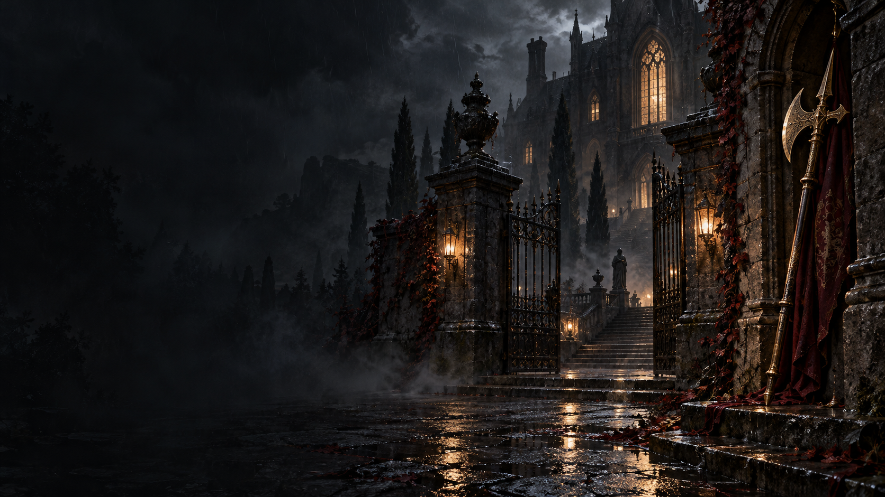

# Ashford's Halberd

**0.9.0b Beta** — see the [changelog](campaign/CHANGELOG.md) and [GitHub release](https://github.com/sergiomanzur/Ashfords-Halberd/releases/tag/v0.9.0b).

An offline Windows fan port of **Resident Evil Code: Veronica X**, running the original campaign natively from your own USA PS2 disc image. Built on the MIT-licensed recvx-enhanced-port and AshfordFamily decompilation, with original Ashford presentation.



## Current state

The Windows x86 campaign builds and boots. New Game, opening dialogue and actors, inventory, fixed-camera movement, third-person movement and live settings persistence have been exercised. Every retail movie has passed decoder verification.

Full room quicksave tests now cover restoring after a room change and loading a persisted snapshot in a fresh process. The latest component run passed 39 tests, with the disc-dependent movie test skipped in that invocation. Targeted first-person tests cover controller look/movement, aiming/firing, inventory return and quicksave/quickload.

This is a working development build. Component tests and opening smoke runs do not establish that every scene, boss or ending is correct.

## Changes in this version

- Single-player throughout.
- Original gothic launcher with disc picker, display selection, volume controls and the original ambient composition **The Quiet Threshold**.
- Newly generated brass/oxblood halberd icon and manor artwork.
- Original **Field Dossier** F1 overlay with category navigation, search, contextual help and an ink/brass palette.
- Shared video, audio, camera, gameplay, appearance and binding preferences in F1 and **OPTION > ENHANCED OPTIONS**.
- Shared **Cheats** page in both menus; F2 is a shortcut. Native tools cover health/ammo, healing, item grants, locks, noclip, spawning, teleportation, unlocks and rank tools. See [research and limitations](docs/cheats.md).

## Enhancements

**Experience preset** in Display or Gameplay offers **Original**, **Enhanced**
and **Custom** in both F1 and OPTION > ENHANCED OPTIONS. Original selects an
original-style picture/control baseline; Enhanced selects widescreen, smooth
frames, modern movement and convenience options. Custom preserves current
choices, and individual adjustments remain available. Existing preferences are
retained. See [preset contents and picture controls](docs/campaign-picture-presets.md).

Display now includes **Saturation** (0–200%, 100% neutral) and optional **FXAA**.
FXAA is off by default and independent of internal resolution; it can soften game
text and fine detail. Picture calibration reset includes saturation.

The [2026-10-24 reliability update](docs/campaign-reliability-2026-10-24.md)
corrects expanded-inventory reload lookup, puzzle/interaction input ownership,
running-to-pushing behavior, the unavailable-vibration pointer loop, and two
presentation scheduling edge cases. Its regression checks include 42,720
reload combinations and display-mode frame-time measurements. Exact late-game
puzzle/stair scenes still need save-based gameplay verification.

Interpolated display-rate presentation, adjustable aspect ratio/FOV, fullscreen/resolution settings, VSync, picture calibration, fog/effect controls and optional user-supplied HD texture packs. The simulation keeps its original timing.

Faster loading, door skipping, automatic stairs, quick knife, optional saving without ink ribbons, difficulty selection and Battle Game access. Rebindable keyboard/mouse/gamepad controls, rumble, modern movement and an optional over-the-shoulder aiming camera. Separate music/voice and sound-effects volumes.

Full room quicksave/quickload captures room objects, local flags, event tasks, graphics and audio during safe player control. Quickslots require the exact executable build; keep native saves for progress across updates. See [controls, restrictions and compatibility](docs/campaign-quicksave.md).

The [Alfred stairway investigation](docs/campaign-alfred-investigation.md) found explicit original-script instructions hiding both Alfred actors before the sound sequence. No speculative actor or visibility change has been applied.

Optional [campaign first person](docs/campaign-first-person.md) is available from Camera mode in both enhancement menus. It reuses Battle Game's head-node eye height through the PC free-camera layer, with mouse/controller look and camera-relative movement. Scripted scenes, incompatible interactions and native weapon scopes retain their original cameras.

## Play

Windows 10 or later and OpenGL 3.3 are required. Extract the complete package, including `assets/` and `licenses/`, then run `AshfordsHalberd.exe`. Choose your own unmodified **USA PS2 ISO (SLUS-20184)** and select **Play Campaign**. The disc path is remembered. No retail game data is included.

| Shortcut | Action |
|---|---|
| F1 | Field Dossier / enhancements |
| F2 | Cheats |
| [ / ] | Previous / next carried weapon |
| F3 / F4 / F6 / F7 | Carried weapon 1 / 2 / 3 / 4 |
| F5 | Toggle third-person camera |
| F8 | Skip the current FMV cutscene |
| F9 / F10 | Quicksave / quickload during safe player control |
| F11 | Toggle fullscreen |
| F12 | Toggle campaign first person |

Fixed-camera defaults: arrows move, W aims, Z interacts/confirms or fires while aiming, X runs/cancels, Enter opens inventory. Third-person defaults: WASD moves, mouse looks, right mouse aims, left mouse fires, Shift runs, E interacts, Q cancels, R reloads and Tab opens inventory. Both enhancement menus expose bindings, including the rebindable F8 FMV-skip action. FMV skipping uses the game's normal fade and cleanup; it does not skip real-time scripted scenes.

Settings and original-format saves live in `%APPDATA%\AshfordsHalberd\Campaign`. Back up this folder. `--save-dir <folder>` overrides it; `--skip-launcher` starts directly. Supply an ISO argument or `RECVX_ISO` for direct/automated startup. Older prototype saves are separate and incompatible.

Controller quicksave defaults: hold L3/LS and press Back/View/Select to save, or Start/Menu/Options to load. These combinations consume the menu button and can be rebound in either enhancement menu.

Controller first person: hold L3/LS and press R3/RS. Modern controls use the left stick to move and right stick to look/aim; first person shares third-person FOV, sensitivity and action bindings. This camera mode uses the existing weapon mechanics without a separate first-person arm/weapon model set.

Weapon shortcuts work in both camera modes. Controller defaults: hold left-stick click (L3/LS) and use D-pad Up/Right/Down/Left for carried weapons 1/2/3/4; hold L3/LS and press LB/RB (PlayStation L1/R1) for previous/next weapon. L3 alone does not switch. The combination consumes its other button until released, preventing an extra quick knife, reload or quick turn. Existing default-only controller settings upgrade automatically; custom assignments remain editable. Rebind all six actions in either enhancement menu's control bindings. Direct slots follow the order of weapons currently carried in the inventory grid; sorting, storing or removing weapons changes that order. Two-slot weapons count once. Empty magazines remain selectable. Switching uses the original weapon/model loader and preserves ammunition. Release aim before switching: attacks, reloads, quick knife, pushing, stairs, damage, menus and scripted actions block the shortcut, with no delayed switch when control returns. Details and checks: [weapon switching](docs/campaign-weapon-switching.md).

## Build

Use an i686 POSIX GCC toolchain. See [campaign build requirements and verification](docs/campaign-backend.md).

```powershell
git submodule update --init upstream/recvx-campaign-decomp
./tools/build-campaign.ps1 -FetchHeaders -ToolchainBin 'C:/path/to/mingw32/bin' -Package
```

Set `RECVX_ISO` to your disc path to include movie tests. Default output is `build/campaign-windows`; this workstation reuses `build/campaign-platform`. Packages exclude retail data, saves, compiler and SDK headers. Build tools fetch pinned dependencies; the game contains no online gameplay.

The earlier x64 research prototype remains accessible through `tools/build.ps1` for room/inventory experiments. The campaign executable is the current playable path.

The legacy prototype remains incomplete: its playable-slice acceptance test still fails because the corridor contains a scripted actor rather than the required original zombie encounter. Its latest run passed the other 166 checks. See [prototype status](docs/step1-slice-status.md).

## Credits

Adapted from [aikatore/recvx-enhanced-port](https://github.com/aikatore/recvx-enhanced-port) 0.6.8, Copyright (c) 2026 aikatore and contributors, MIT, and the [AshfordFamily decompilation](https://github.com/AshfordFamily/recvx-decomp). Attribution is retained in [source provenance](campaign/PROVENANCE.md) and [third-party notices](campaign/THIRD_PARTY_NOTICES.md). [Original artwork/music provenance](assets/branding/PROVENANCE.md) includes the generation prompts and composition source.

Resident Evil and Code: Veronica belong to Capcom. This unofficial project is not affiliated with or endorsed by Capcom, Sony, Sega or CRI Middleware.
